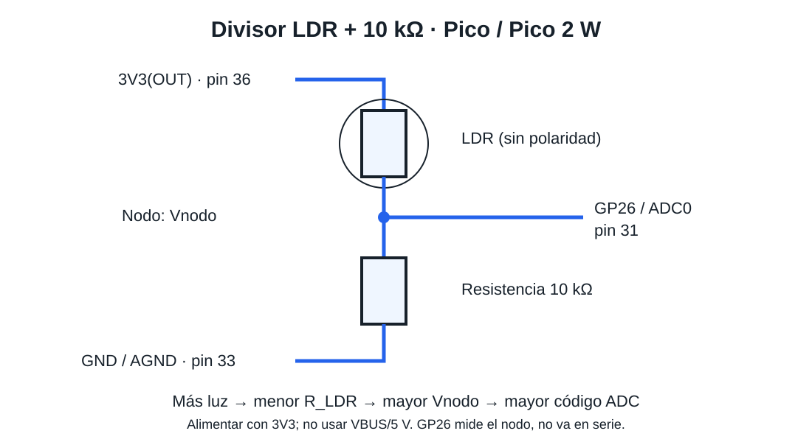

# ADC en RP2040 y RP2350 con fotoresistencia LDR

**Actividad integradora por equipos · Equipo 1 · Periférico: ADC**

Integrantes: Yohualli Ollin Luna Reyes y Diego Navarro Sanchez

---

## 1. Objetivo

Configurar y demostrar el **convertidor analógico-digital (ADC)** de la Raspberry Pi Pico (**RP2040**) y la Raspberry Pi Pico 2 W (**RP2350**) para observar cambios de luz con una **LDR y una resistencia de 10 kΩ en divisor de voltaje**, utilizando:

1. **Acceso directo a registros mediante punteros**.
2. La **implementación equivalente con Raspberry Pi Pico SDK**.
3. Un comando integrado al REPL: `luz <regs|sdk>`.
4. Comparación técnica entre RP2040 y RP2350.

Cadena demostrada:

```text
Control: REPL -> C (argc/argv) -> backend regs o SDK -> ADC
Señal: luz -> resistencia LDR -> divisor -> GP26/ADC0 -> ADC -> voltaje y escala ADC
```

## 2. Descripción del hardware

El ADC convierte el voltaje del nodo del divisor a un código de 12 bits (0–4095). La LDR es una resistencia que disminuye al recibir más luz; no genera un voltaje por sí sola.

## 3. Lista de componentes

| Cantidad | Componente |
|---:|---|
| 1 | Raspberry Pi Pico (RP2040) |
| 1 | Raspberry Pi Pico 2 W (RP2350A) |
| 1 | Fotoresistencia LDR de dos terminales |
| 1 | Resistencia de 10 kΩ |
| 1 | Protoboard y jumpers suficientes |
| 1 | Cable USB de datos compatible |

Para los comandos auxiliares conservados: LED externo en GP15 con resistencia en serie de 330 Ω a GND; pulsador entre GP13 y 3V3 (pull-down interno). No son necesarios para `luz`.

## 4. Conexiones y fórmulas



**3V3 → LDR → nodo a GP26/ADC0 → resistencia 10 kΩ → GND.**

| Pico / Pico 2 W | Pin físico | Conexión |
|---|---:|---|
| 3V3(OUT) | 36 | Un extremo de la LDR |
| GP26 / ADC0 | 31 | Nodo común: otro extremo de la LDR y un extremo de 10 kΩ |
| AGND (GND analógica) | 33 | Otro extremo de la resistencia de 10 kΩ |

La LDR y la resistencia no tienen polaridad. Se usa la alimentación de la tarjeta que se esté probando; no unir las salidas 3V3 de ambas tarjetas. No alimentar el divisor desde VBUS/5 V.

```text
Vnodo = V3V3 × 10000 / (R_LDR + 10000)       [resistencias en ohmios]
Vestimado = raw × 3.3 / 4096                 [voltios; referencia nominal]
Escala ADC (%) = raw × 100 / 4095
```

Más luz → menor R_LDR → mayor Vnodo → mayor código ADC. Al cubrir la LDR ocurre lo contrario. La escala ADC normaliza el código, **no mide lux ni porcentaje físico de iluminación**. No se supone una curva universal de la LDR: para estimar lux hacen falta su modelo y calibración. La conversión a voltaje depende de la referencia real.

Se conserva 4096 para el tamaño de paso del ADC y se usa 4095 para que el código máximo represente 100 % de escala.

## 5. Software y herramientas

- Raspberry Pi Pico SDK 2.x.
- CMake.
- Toolchain ARM GCC.
- Terminal serie USB para el REPL.
- Editor o IDE compatible con Pico SDK.

## 6. Compilación

Definir `PICO_SDK_PATH` y compilar una vez por tarjeta.

### RP2040 - Raspberry Pi Pico

```bash
cmake -S firmware -B build_pico -DPICO_BOARD=pico
cmake --build build_pico
```

### RP2350 - Raspberry Pi Pico 2 W

```bash
cmake -S firmware -B build_pico2w -DPICO_BOARD=pico2_w
cmake --build build_pico2w
```

Los archivos `ADC_LDR.uf2` quedan dentro de cada carpeta de compilación.

## 7. Carga del programa

1. Desconectar la tarjeta.
2. Mantener presionado **BOOTSEL** y conectar USB.
3. Copiar el `.uf2` correspondiente a la unidad que aparece.
4. Abrir la terminal serie USB.

## 8. Uso del REPL

Comando del equipo:

```text
luz regs
luz sdk
```

Ejemplo numérico ilustrativo; no es una captura física:

```text
RP2040> luz regs
argv[1]    : regs
Tarjeta    : Raspberry Pi Pico (RP2040)
Backend    : registros y punteros
ADC bruto  : 2048 / 4095
Voltaje    : 1.650 V
Escala ADC : 50.0 % (no lux)
```

`regs` ejecuta la lectura mediante direcciones, offsets, punteros `volatile`, máscaras y campos de bits. `sdk` ejecuta la misma función con `adc_init()`, `adc_gpio_init()`, `adc_select_input()` y `adc_read()`.

## 9. Implementación mediante registros

Archivo: `firmware/src/adc_regs.c`.

Secuencia utilizada:

```text
Dirección base -> offset -> dirección del registro -> puntero volatile -> valor -> ADC
```

La implementación directa:

1. Saca el ADC de reset mediante `RESETS`.
2. Configura `IO_BANK0.GPIO26_CTRL.FUNCSEL = NULL` para desconectar funciones digitales.
3. Configura el pad de GP26 como entrada analógica, sin pulls ni receptor digital.
4. En RP2350 también elimina el aislamiento `ISO` del pad.
5. Habilita el ADC con `CS.EN`.
6. Selecciona ADC0 mediante `CS.AINSEL = 0`.
7. Inicia una conversión con `CS.START_ONCE`.
8. Espera `CS.READY` y lee los 12 bits de `RESULT`.

El mapa usado está documentado en `docs/03_mapa_registros.md`.

## 10. Implementación mediante SDK

Archivo: `firmware/src/adc_sdk.c`.

```c
adc_init();
adc_gpio_init(26);
adc_select_input(0);
uint16_t raw = adc_read();
```

El SDK abstrae direcciones base, diferencias del mapa de memoria, preparación del GPIO, reset del periférico y máscaras de bits.

## 11. Diferencias RP2040 / RP2350

| Elemento | RP2040 | RP2350 en Pico 2 W |
|---|---|---|
| ADC | SAR, 12 bits, 500 kS/s | SAR, 12 bits, 500 kS/s |
| ENOB indicado por SDK | 8.7 | 9.2 |
| `ADC_BASE` | `0x4004C000` | `0x400A0000` |
| `RESETS_BASE` | `0x4000C000` | `0x40020000` |
| `IO_BANK0_BASE` | `0x40014000` | `0x40028000` |
| `PADS_BANK0_BASE` | `0x4001C000` | `0x40038000` |
| ADC externos en la placa | GPIO26-29 | GPIO26-29 |
| `CS.AINSEL` | bits [14:12] | bits [15:12] |
| `CS.RROBIN` | 5 bits | hasta 9 bits en RP2350; Pico 2 W usa RP2350A |
| Pad `ISO` | no existe | existe y debe quedar en 0 |

Detalles: `docs/05_comparacion_RP2040_RP2350.md`.

## 12. Procedimiento para reproducir la demostración

1. Conectar el divisor LDR + 10 kΩ según `diagramas/conexiones.svg`.
2. Cargar el firmware en la Raspberry Pi Pico.
3. Ejecutar `luz regs` y registrar la lectura.
4. Ejecutar `luz sdk` y comprobar que la lectura es equivalente.
5. Cubrir la LDR y repetir ambos comandos; ADC, voltaje y escala deben bajar. Iluminarla y repetir; deben subir. Mantener luz estable al comparar backends; no se exige igualdad exacta ni alcanzar los extremos 0 y 4095.
6. Repetir los pasos en Raspberry Pi Pico 2 W.
7. Mostrar durante la explicación las direcciones y campos indicados en `docs/03_mapa_registros.md`.

## 13. Referencias técnicas

- Raspberry Pi Ltd., **RP2040 Datasheet**: https://datasheets.raspberrypi.com/rp2040/rp2040-datasheet.pdf
- Raspberry Pi Ltd., **RP2350 Datasheet**: https://datasheets.raspberrypi.com/rp2350/rp2350-datasheet.pdf
- Raspberry Pi Ltd., **Pico 2 W Datasheet**: https://datasheets.raspberrypi.com/picow/pico-2-w-datasheet.pdf
- Raspberry Pi Ltd., **Pico SDK - hardware_adc**: https://www.raspberrypi.com/documentation/pico-sdk/hardware.html#hardware_adc
- Adafruit, **Photocells** (principio del divisor; aquí alimentado a 3.3 V): https://learn.adafruit.com/photocells/using-a-photocell

## 14. Estado de validación

Las pruebas físicas en ambas tarjetas quedan pendientes. Los ejemplos son cálculos ilustrativos. Completar `evidencias/` únicamente con capturas y mediciones reales.

Se verificó la lógica de `main.c` con GCC y backends simulados en el equipo de desarrollo, para ambas selecciones de plataforma: argumentos inválidos, 16 lecturas por comando y códigos 0, 2048 y 4095. Se corrigió el cálculo de microvoltios para multiplicar en 64 bits y evitar desbordamiento al usar todo el rango de la LDR. No equivale a compilar con Pico SDK ni a ejecutar en las tarjetas: ambas comprobaciones quedan pendientes.
