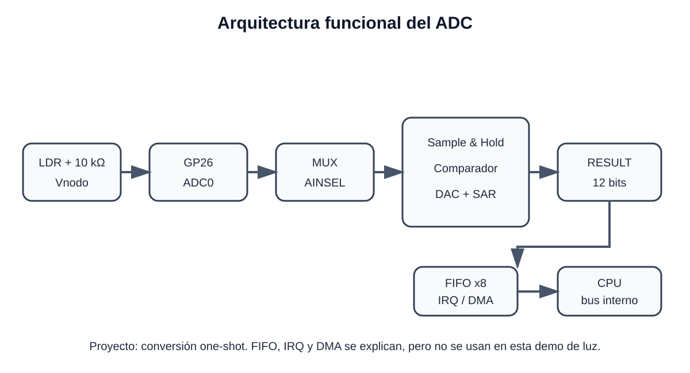

# 2. Arquitectura del ADC

## Diagrama funcional

## Bloques principales

1. **Entrada analógica / GPIO:** para este proyecto, GP26 corresponde a ADC0.
2. **Multiplexor analógico:** selecciona qué canal entra al convertidor.
3. **Sample and hold:** mantiene estable la tensión durante la conversión.
4. **SAR + DAC + comparador:** realiza la búsqueda binaria que genera el resultado de 12 bits.
5. **RESULT:** conserva el resultado más reciente.
6. **FIFO de 8 muestras:** permite almacenar resultados en captura continua.
7. **Interrupción y DREQ:** permiten atender la FIFO mediante CPU o DMA.
8. **Bus interno:** permite a la CPU leer y escribir los registros del ADC.

## Relación con CPU y bus interno

El ADC está mapeado en memoria. Desde C, una dirección absoluta se convierte a un puntero `volatile uint32_t *`. Al desreferenciarlo, la CPU realiza una operación real sobre el registro del periférico.

El programa de este proyecto solo necesita conversiones **one-shot**: inicia una conversión y espera a que termine. Por esta razón FIFO, DMA e interrupciones se explican como opciones del periférico, pero no son necesarios para la demostración.

## Entradas y GPIO

### Raspberry Pi Pico - RP2040

- ADC0 -> GPIO26
- ADC1 -> GPIO27
- ADC2 -> GPIO28
- ADC3 -> GPIO29 dentro del chip; en la placa Pico parte del circuito usa ADC3 para VSYS.
- Canal adicional -> sensor interno de temperatura.

### Raspberry Pi Pico 2 W - RP2350A

- ADC0 -> GPIO26
- ADC1 -> GPIO27
- ADC2 -> GPIO28
- ADC3 -> GPIO29 dentro del chip/placa según función disponible.
- Canal adicional -> sensor interno de temperatura.

El proyecto utiliza únicamente **ADC0 / GP26**, común a ambas placas.

## Reloj

El ADC utiliza un reloj independiente de **48 MHz**. Una conversión requiere 96 ciclos, por lo que la tasa máxima nominal es **500 kS/s**.

## FIFO, interrupciones y DMA

- La FIFO tiene 8 posiciones.
- `FCS.EN` permite guardar automáticamente cada resultado.
- `FCS.THRESH` define el nivel que puede generar una solicitud.
- El periférico puede generar interrupción cuando la FIFO alcanza el umbral.
- El DREQ del ADC puede solicitar transferencias DMA.

No se activan en la práctica porque esta demostración de iluminación solo requiere lecturas bajo demanda.

## Configuraciones principales del periférico

- Selección de canal con `CS.AINSEL`.
- Conversión única con `CS.START_ONCE`.
- Modo continuo con `CS.START_MANY`.
- Muestreo round-robin con `CS.RROBIN`.
- Divisor de muestreo con `DIV`.
- FIFO y umbral mediante `FCS`.
- Interrupciones mediante `INTE/INTS`.
- Sensor interno mediante `CS.TS_EN`.

Para el divisor LDR se usa canal 0, conversión única y FIFO deshabilitada.
