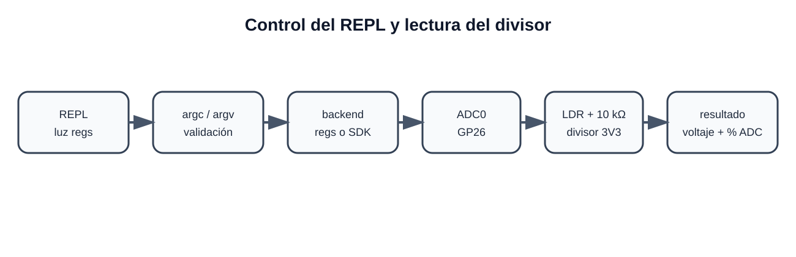

# 6. Comando integrado al REPL

## Sintaxis

```text
luz <regs|sdk>
```

Ejemplos válidos:

```text
luz regs
luz sdk
```

## Validación con `argc` y `argv`

El comando exige exactamente dos argumentos contando el nombre del comando:

```c
if (argc != 2) {
    printf("Uso: luz <regs|sdk>\n");
    return -1;
}
```

`argv[0]` contiene `luz` y `argv[1]` contiene `regs` o `sdk`.

```c
if (strcmp(argv[1], "regs") == 0) {
    backend = &adc_backend_regs;
} else if (strcmp(argv[1], "sdk") == 0) {
    backend = &adc_backend_sdk;
} else {
    printf("Error: backend invalido '%s'\n", argv[1]);
    return -1;
}
```

## Funcionamiento

1. El REPL recibe el texto.
2. `split_line()` lo divide en `argc` y `argv`.
3. Se localiza el comando `luz`.
4. Se valida `argv[1]`.
5. Se inicializa el backend seleccionado.
6. Se realizan 16 lecturas de ADC0 y se obtiene un promedio.
7. Se convierte la lectura a voltaje usando 3.3 V nominales.
8. Se calcula la escala ADC: `raw × 100 / 4095` (no lux).
9. El resultado se imprime en el REPL.

## Cadena completa



```text
Control: REPL -> comando C -> backend -> registros/SDK -> ADC
Señal: luz -> LDR + 10 kΩ -> GP26 -> ADC -> voltaje y escala ADC
```

## Ejemplo ilustrativo, no evidencia física

```text
RP2350> luz regs
argv[1]   : regs
Backend   : registros y punteros
ADC bruto : 2048 / 4095
Voltaje   : 1.650 V
Escala ADC : 50.0 % (no lux)
```

Al iluminar la LDR, bajará su resistencia y subirán el voltaje y el código ADC. Al cubrirla bajarán. La respuesta no es lineal en lux. Se conserva el promedio redondeado de 16 muestras y una espera de 2 ms por muestra.

## Errores validados

```text
RP2350> luz
Uso: luz <regs|sdk>

RP2350> luz otra
Error: backend invalido 'otra' (usa regs o sdk)
```

Esto demuestra el uso de `argc` y `argv` solicitado para el comando del equipo.

## Aritmética de la nueva entrada

La LDR puede recorrer gran parte del rango ADC. El producto `raw × 3300000` puede superar 32 bits; `main.c` convierte `raw` a `uint64_t` antes de multiplicar y guarda el resultado final en `uint32_t`. Se evita así que voltajes altos se impriman como valores bajos por desbordamiento.
